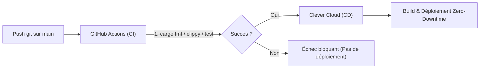

# 🚀 Guide Déploiement & Base de Données

Ce document résume le fonctionnement de la base de données MongoDB en local (Docker) et la procédure de migration/déploiement vers Clever Cloud.

---

## 🗄️ 1. Base de données locale (Docker)

Un fichier `docker-compose.yml` est présent à la racine pour faire tourner MongoDB 7.0 localement.

### Commandes utiles

- **Démarrer MongoDB en arrière-plan** :
  ```bash
  docker compose up -d
  ```
- **Vérifier l'état du conteneur** :
  ```bash
  docker ps
  ```
- **Consulter les logs** :
  ```bash
  docker compose logs -f mongodb
  ```
- **Tester la connexion (ping)** :
  ```bash
  docker exec lan_tournament_mongo mongosh --eval "db.adminCommand('ping')"
  ```
- **Arrêter MongoDB** :
  ```bash
  docker compose down
  ```

> 💡 **Persistance** : Les données sont stockées dans le volume Docker `lan_tournament_manager_mongo_data`. Elles ne sont pas perdues lors d'un `docker compose down`.

---

## ⚙️ 2. Configuration (`.env`)

Dans le fichier `.env` à la racine :

```dotenv
JWT_SECRET=une_phrase_secrete_vraiment_longue_et_aleatoire_de_64_caracteres
MONGODB_ADDON_URI=mongodb://localhost:27017/lan_tournament
```

---

## ☁️ 3. Déploiement & Migration vers Clever Cloud

### Étape A : Créer l'Add-on sur Clever Cloud
1. Sur la console [Clever Cloud](https://console.clever-cloud.com/), clique sur **Create...** > **an add-on**.
2. Choisis **MongoDB**.
3. Sélectionne le plan **XS Small Space** (5 GB d'espace, 1 GB RAM, facturé à la minute ~0.024 €/h).
4. Sélectionne la zone **Paris** (ou Roubaix/Gravelines).
5. Nomme l'add-on (ex. `lan-tournament-mongo`).

### Étape B : Lier l'Add-on à l'Application Rust
- Dans l'application Rust sur Clever Cloud, va dans l'onglet **Service dependencies**.
- Ajoute l'add-on MongoDB : Clever Cloud injectera automatiquement la variable `MONGODB_ADDON_URI`.

### Étape C : Migration des données (Local ➔ Clever Cloud)
Si tu souhaites transférer des jeux, barèmes ou données créés en local vers Clever Cloud :

1. **Exporter les données locales** :
   ```bash
   docker exec -it lan_tournament_mongo mongodump --db lan_tournament --out /dump
   docker cp lan_tournament_mongo:/dump ./mongo_backup
   ```

2. **Importer vers Clever Cloud** :
   ```bash
   mongorestore --uri="<VOTRE_MONGODB_ADDON_URI_CLEVER>" ./mongo_backup/lan_tournament/
   ```

---

## 🏗️ 4. Architecture Monorepo (Front & Back)

Le dépôt contient à la fois le code backend et le frontend. Deux stratégies sont possibles sur Clever Cloud :

### Option A : Servi directement par Axum (Approche actuelle)
- **Fonctionnement** : Le backend Rust sert lui-même les fichiers statiques HTML/CSS/JS du dossier `static/` via `tower-http::services::ServeDir`.
- **Sur Clever Cloud** : Une seule application Rust est nécessaire.
- **Avantages** :
  - Zéro problème de CORS.
  - Déploiement atomique (front et back toujours synchronisés).
  - Clever Cloud injecte la variable `PORT` (8080 par défaut), Axum écoute sur `0.0.0.0:$PORT`.

### Option B : Frontend séparé (SPA React / Vue / Vite)
- Si le frontend devient une application Node.js autonome dans un sous-dossier (ex. `/frontend`) :
  - Créer **deux applications** sur Clever Cloud reliées au **même dépôt Git**.
  - Définir la variable d'environnement `APP_FOLDER` pour chacune :
    - App Back : `APP_FOLDER=.` (ou `APP_FOLDER=backend`)
    - App Front : `APP_FOLDER=frontend`

---

## 🔄 5. Pipeline CI/CD (Alternative à GCP Cloud Build)

Pour reproduire un pipeline automatisé type GCP (Cloud Build + Cloud Run), la pratique recommandée avec Clever Cloud est d'utiliser **GitHub Actions** :



### Fonctionnement recommandé :
1. **CI (Continuous Integration)** via GitHub Actions :
   - Exécution de `cargo fmt --check`
   - Analyse statique `cargo clippy -- -D warnings`
   - Lancement des tests `cargo test`
2. **CD (Continuous Deployment)** vers Clever Cloud :
   - Si les tests passent, le workflow déclenche le déploiement sur Clever Cloud :
     - Soit via le CLI officiel `clever-tools` (en fournissant un token API Clever Cloud dans les secrets GitHub).
     - Soit via un `git push` SSH direct vers le remote Clever Cloud.

